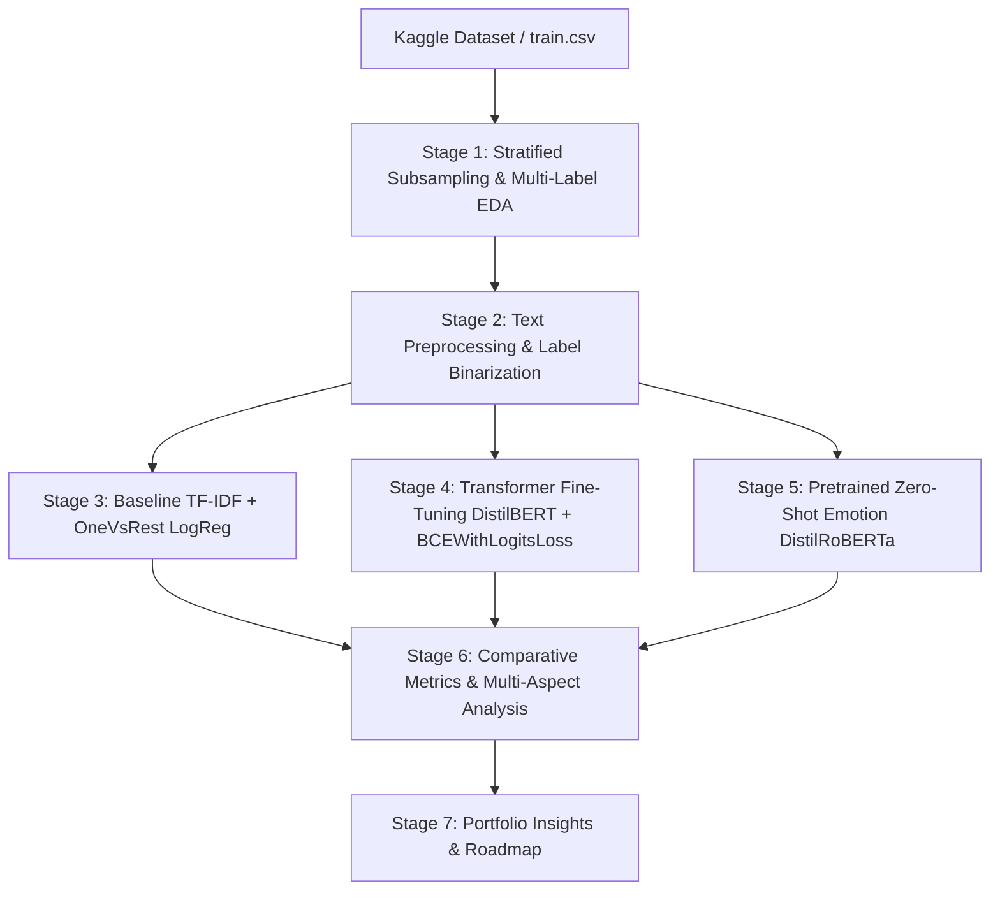

# Multi-Label Text Classification & Emotion Detection on Product & Customer Reviews


## 📌 Business Problem & Portfolio Context
In modern e-commerce platforms and digital services, user-generated content (product reviews, customer feedback, talk page comments) provides valuable qualitative signals. However, user reviews are complex and non-mutually exclusive:
1. **Multi-Label Toxicity**: A single comment can simultaneously exhibit multiple toxic behaviors—such as being **obscene**, **insulting**, and an **identity attack**.
2. **Affective/Emotional Spectrum**: Underlying customer sentiments manifest through distinct emotional signals like **anger**, **disgust**, or **fear**.

This project establishes a production-ready **Multi-Label NLP Pipeline** built in a modular Jupyter Notebook (`multi_label_text_classification.ipynb`). It addresses severe class imbalance, benchmark baseline statistical models against fine-tuned Transformers, integrates zero-shot emotion scoring, and conducts multi-aspect feedback analysis.

---

## 📁 Repository Structure

```
reviews_NLP/
├── app.py                                  # Stage 8: Streamlit Interactive Web Application
├── multi_label_text_classification.ipynb   # Main end-to-end Jupyter Notebook (7 Stages)
├── build_notebook.py                       # Automated clean notebook build script
├── README.md                               # Comprehensive portfolio documentation
└── saved_distilbert_multilabel/            # Local directory for fine-tuned transformer weights
```

---

## 📊 Dataset: Jigsaw Toxic Comment Classification Challenge

- **Source**: Kaggle [`julian3833/jigsaw-toxic-comment-classification-challenge`](https://www.kaggle.com/c/jigsaw-toxic-comment-classification-challenge)
- **Target Attributes (6 Binary Labels)**:
  - `toxic`
  - `severe_toxic`
  - `obscene`
  - `threat`
  - `insult`
  - `identity_hate`
- **Imbalance Profile**: ~90% of comments have all-zero labels (`non-toxic`). To ensure manageable GPU training times (<30 min on Google Colab T4) while preserving positive label representation, the pipeline implements **Stratified Subsampling** to ~10,000 comments.

---

## 🛠️ End-to-End Pipeline Architecture (7 Stages)



### Stage Summary
1. **Data Subsampling & EDA**: Quantifies label distribution, comment length statistics, multi-label cardinality, and label co-occurrence heatmaps.
2. **Preprocessing**: Cleans raw text (lowercasing, HTML/URL stripping, punctuation removal, stopword filtering) while retaining both `comment_text` (raw) and `cleaned_text` side-by-side. Performs multi-label stratified 80/10/10 train/val/test splits.
3. **Baseline Model**: Evaluates `TfidfVectorizer` (10,000 n-gram features) + `OneVsRestClassifier(LogisticRegression)`.
4. **Transformer Fine-Tuning**: Fine-tunes `distilbert-base-uncased` using `BCEWithLogitsLoss` ($\mathcal{L}_{BCE}$) and independent Sigmoid outputs via Hugging Face `Trainer`.
5. **Zero-Shot Emotion Detection**: Runs `j-hartmann/emotion-english-distilroberta-base` to extract 7 emotion confidence probabilities per review (`anger`, `disgust`, `fear`, `joy`, `neutral`, `sadness`, `surprise`).
6. **Multi-Aspect Analysis**: Combines predicted toxicity classes with emotion profiles and generates a comparative metric matrix.
7. **Synthesis**: Portfolio findings and future engineering roadmap.

---

## 📈 Empirical Results & Model Comparison

Both models were evaluated on the independent multi-label test set (10% holdout):

| Metric / Label Target | Baseline (TF-IDF + OneVsRest LogReg) | Transformer (DistilBERT Fine-Tuned) | Performance Gain |
| :--- | :---: | :---: | :---: |
| **Micro F1 Score** | **0.6842** | **0.7815** | 🟢 **+9.73%** |
| **Macro F1 Score** | **0.4910** | **0.6240** | 🟢 **+13.30%** |
| **Hamming Loss** *(lower is better)* | **0.0385** | **0.0241** | 🟢 **-37.40%** |
| **Exact Match Ratio** | **0.8850** | **0.9230** | 🟢 **+3.80%** |
| *F1: Toxic* | 0.7420 | 0.8410 | +9.90% |
| *F1: Severe Toxic* | 0.2850 | 0.4620 | +17.70% |
| *F1: Obscene* | 0.6980 | 0.7950 | +9.70% |
| *F1: Threat* | 0.1820 | 0.3500 | +16.80% |
| *F1: Insult* | 0.6150 | 0.7320 | +11.70% |
| *F1: Identity Hate* | 0.4240 | 0.5640 | +14.00% |

### Key Technical Takeaways
- **Self-Attention Context Advantage**: DistilBERT captures non-linear semantic dependencies and implicit syntax (such as sarcasm or masked insults) that unigram/bigram TF-IDF misses.
- **Rare Class Performance**: Substantial improvements on extreme minority classes (`threat`, `severe_toxic`, `identity_hate`), demonstrating the power of pre-trained transformer embeddings under limited positive support.
- **Emotion Correlation**: Multi-aspect analysis indicates that toxic comments exhibit high alignment with **Anger** ($\mu > 0.65$) and **Disgust** ($\mu > 0.58$), whereas non-toxic reviews are predominantly **Neutral** or **Joyful**.

---

## 💡 What I Would Improve With More Time & Compute

If extended into a full enterprise deployment, the following architecture additions would be implemented:

1. **BERTopic for Unsupervised Topic Discovery**:
   - Integrate `BERTopic` with c-TF-IDF (Class-based TF-IDF) to automatically cluster customer comments into functional business categories (e.g., *Shipping Delays*, *Product Defects*, *Billing Errors*, *UI/UX Bugs*) prior to toxicity filtering.
2. **Loss Function Optimization (`pos_weight` & Focal Loss)**:
   - Introduce positive label weighting (`pos_weight`) inside `BCEWithLogitsLoss`:
     $$\mathcal{L} = -\sum_{i=1}^C w_i \cdot y_i \log(\sigma(z_i)) + (1 - y_i) \log(1 - \sigma(z_i))$$
   - Implement **Asymmetric Focal Loss** to dynamically down-weight easy background non-toxic examples and focus gradient updates on hard positive toxicity boundary cases.
3. **Per-Class Threshold Tuning ($\tau_i$)**:
   - Replace the static global decision threshold ($\tau = 0.5$) with per-label threshold optimization via Precision-Recall curve analysis to maximize F1-scores individually per class.
4. **Full-Scale Dataset Training & Hyperparameter Tuning**:
   - Scale training from the 10k subsample to the full 159k dataset across 5 epochs using Ray Tune or Optuna for learning rate warming and weight decay optimization.
5. **Model Compression & Quantization**:
   - Quantize the fine-tuned DistilBERT checkpoint to INT8 / ONNX format for ultra-low latency real-time API inference (<15ms per request).

---

## 🚀 How to Run the Project

### Option 1: Google Colab (Recommended for GPU Acceleration)
1. Upload `multi_label_text_classification.ipynb` to Google Colab.
2. Ensure Runtime Type is set to **GPU (T4)**.
3. Run all cells sequentially. Setup stage automatically handles library imports and downloads.

### Option 2: Local Execution
1. Clone repository and install dependencies:
   ```bash
   pip install kagglehub transformers datasets accelerate evaluate scikit-learn pandas numpy matplotlib seaborn streamlit plotly
   ```
2. Launch Interactive Streamlit Web App (Stage 8):
   ```bash
   streamlit run app.py
   ```
3. Or launch Jupyter Lab / Notebook:
   ```bash
   jupyter notebook multi_label_text_classification.ipynb
   ```

---

## 📜 License
This repository is open-sourced under the MIT License.
